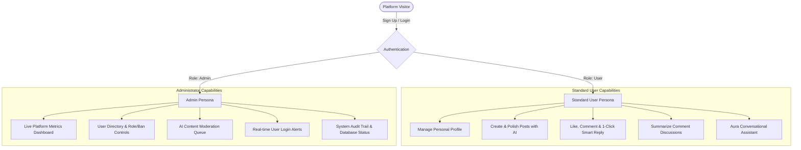
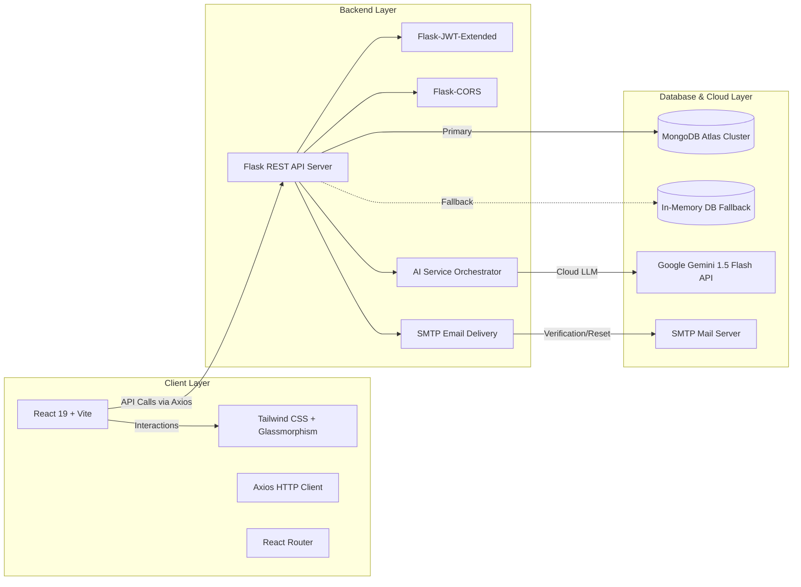

# 🌐 Project Overview: AI-Powered Social Media Platform

---

## 📌 Table of Contents
- [1. Executive Summary](#1-executive-summary)
- [2. Problem Statement](#2-problem-statement)
- [3. Proposed Solution](#3-proposed-solution)
- [4. User Personas & Roles](#4-user-personas--roles)
- [5. System Architecture](#5-system-architecture)
- [6. Core Application Modules](#6-core-application-modules)
- [7. Feature Status Matrix](#7-feature-status-matrix)

---

## 1. Executive Summary

The **AI-Powered Social Media Platform** is a full-stack, enterprise-grade web application engineered to combine modern social networking ergonomics (inspired by Threads, Instagram, and LinkedIn) with cutting-edge artificial intelligence. 

By integrating Google Gemini LLM capabilities directly into the content creation and community management pipelines, the platform empowers creators with smart post generation, automated tone refinement, thread summarization, and safety moderation, while providing administrators with real-time analytics and security telemetry.

---

## 2. Problem Statement

Traditional social media platforms suffer from several recurring friction points:
1. **Creator Fatigue**: Users struggle to formulate captivating post hooks, format captions, and select relevant hashtags consistently.
2. **Comment Information Overload**: Long, multi-threaded discussions make it time-consuming to grasp key community takeaways.
3. **Reactive Moderation**: Harmful or toxic content often remains visible for hours before manual review takes place.
4. **Administrative Blind Spots**: Community operators lack real-time visibility into authentication anomalies and user activity.

---

## 3. Proposed Solution

Our platform solves these challenges through an integrated full-stack architecture:
- **Intelligent Assistant Pipeline**: In-editor AI tools that craft hooks, rewrite captions to match target tones (`Professional`, `Witty`, `Inspirational`, `Casual`), and suggest contextual 1-click replies.
- **Discussion Synthesizer**: 1-click thread summarization that extracts key sentiments and bulleted highlights from community comments.
- **Proactive AI Guard**: Pre-publication and server-side content screening using toxicity scoring to flag offensive language before it spreads.
- **Admin Command Center**: Real-time platform oversight, login notifications, moderation queue management, and user auditing.

---

## 4. User Personas & Roles

### 4.1 Standard User
- **Profile Management**: Customize bio, avatar, and display name.
- **Feed Interaction**: Publish posts with text, images, and hashtags; like and comment on community content.
- **AI Creator Tools**: Generate captions, polish tone, and view thread summaries.
- **Notifications**: Receive instant alerts when other users like or comment on their posts.

### 4.2 Administrator
- **Dashboard Telemetry**: Monitor total users, active accounts, total posts, comments, flagged content, and 24h logins.
- **User Governance**: Search users, promote/demote roles (`user` vs `admin`), and suspend/ban abusive accounts.
- **Content Moderation**: Review posts flagged by the AI safety guard with toxicity scores and dismiss or delete them.
- **Security Alerts**: Receive automated notifications every time any user logs into the platform.

---

## 5. System Architecture

---

## 6. Core Application Modules

1. **Authentication Module (`server/app/routes/auth.py`)**:
   - Registration, login, email verification code delivery, and password reset flows.
2. **Social Feed Module (`server/app/routes/posts.py`)**:
   - Feed retrieval with pagination, post author population, like toggling, and comment threads.
3. **AI Intelligence Module (`server/app/routes/ai.py` & `ai_service.py`)**:
   - Caption generator, tone polisher, thread summarizer, smart replies generator, content safety guard, and Aura chat assistant.
4. **Admin Module (`server/app/routes/admin.py`)**:
   - Metrics aggregation, user management, moderation queue review, and audit logging.
5. **Notification Module (`server/app/routes/notifications.py`)**:
   - User interaction notifications and administrative login alerts.
6. **User Module (`server/app/routes/users.py`)**:
   - User profile endpoints and author post histories.

---

## 7. Feature Status Matrix

| Module | Feature | Status | Notes |
|---|---|---|---|
| **Auth** | User Registration & Login | ✅ Implemented | Bcrypt + JWT access tokens |
| **Auth** | Email Verification (SMTP) | ✅ Implemented | SMTP with local console fallback |
| **Auth** | Forgot & Reset Password | ✅ Implemented | Secure 6-digit verification tokens |
| **Feed** | Create, Edit, Delete Posts | ✅ Implemented | With image URL support & hashtags |
| **Feed** | Like & Comment Threads | ✅ Implemented | Real-time counts & notifications |
| **Feed** | Direct File Uploads (S3/Local) | 🟡 Planned | Currently supports external image URLs |
| **Social** | Follow / Unfollow System | 🟡 In Progress | Database schema ready; API in progress |
| **Social** | Direct Peer Messaging | 🟡 Planned | Schema designed; WebSockets planned |
| **AI** | Post & Caption Generation | ✅ Implemented | Multi-tone (Casual, Pro, Witty, Inspiring) |
| **AI** | Tone Rewriting & Polish | ✅ Implemented | 1-click post refinement |
| **AI** | Discussion Summarization | ✅ Implemented | Post & comment sentiment recap |
| **AI** | Smart Contextual Replies | ✅ Implemented | 3 quick-reply suggestions |
| **AI** | Content Moderation Guard | ✅ Implemented | Toxicity scoring with flag alerts |
| **AI** | Aura Chatbot Assistant | ✅ Implemented | Conversational social media strategist |
| **Admin** | Metric Dashboard & Stats | ✅ Implemented | Live counters & DB engine status |
| **Admin** | User Directory & Ban/Role | ✅ Implemented | Search, promote/demote, suspend |
| **Admin** | Moderation Queue | ✅ Implemented | Dismiss flags or delete violations |
| **Admin** | Real-time Login Alerts | ✅ Implemented | Automatic alerts sent to admins on login |
