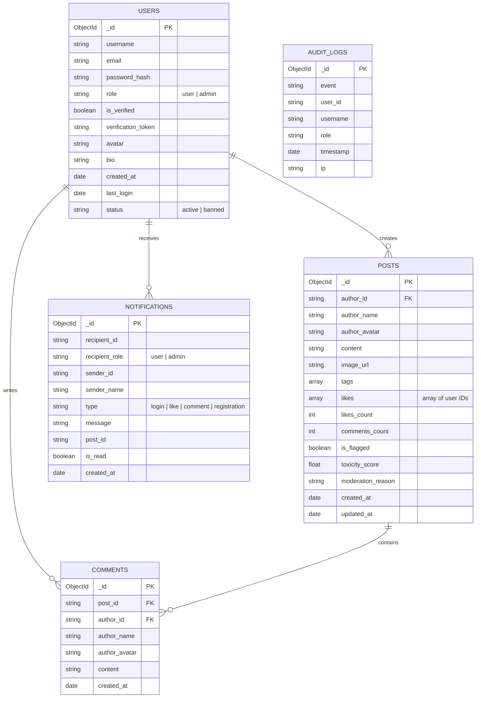

# 🌟 Aura — AI-Powered Social Media Platform

An enterprise-grade, full-stack social media application engineered with **React**, **Flask**, and **MongoDB**, featuring end-to-end authentication, dual user personas (**Admin** and **User**), real-time notifications, interactive social feeds, and a complete suite of **AI-powered creators & assistants**.

**GitHub Repository**: [https://github.com/uttam-kalsariya/AI-Powered-Social-Media-Platform.git](https://github.com/uttam-kalsariya/AI-Powered-Social-Media-Platform.git)

---

## 🚀 Key Features

### 1. 🔐 Robust Authentication & Security
- **Registration & Login**: Secure credential authentication powered by `bcrypt` password hashing and `Flask-JWT-Extended`.
- **Email Verification**: Generates verification tokens sent via SMTP (with dev console preview mode for local environments).
- **Password Reset**: End-to-end tokenized forgot-password and reset-password workflow.
- **Admin Login Alerts**: Real-time notifications dispatched to administrators whenever any user logs in.

### 2. 👥 Two User Personas
- **Administrator**:
  - Full platform overview & metrics: Total users, active users, posts, comments, moderation flags, and 24h logins.
  - User management: Search, inspect last login, grant/revoke admin rights, ban/unban accounts.
  - Content moderation queue: Inspect AI toxicity scores, dismiss flags, or delete inappropriate content.
  - Audit logs: Track user logins, signups, and admin actions.
- **Standard User**:
  - Create and manage personal profile (custom bio and avatars).
  - Publish rich posts with optional images and hashtags.
  - Like, comment, and engage with live feeds.
  - Manage and edit own content.
  - Receive interactive notifications for likes and comments.

### 3. 🤖 AI Agent Integration (Full Suite)
1. **AI Post Generation**: Creates compelling, formatted posts from a topic and chosen tone (`Casual`, `Professional`, `Witty`, `Inspirational`).
2. **AI Tone Rewriting & Polish**: One-click content rephrasing into professional, witty, or inspirational tones.
3. **AI Discussion Summarization**: Instant multi-point summaries highlighting the key discussion sentiments in post threads.
4. **AI Smart Replies**: Contextual 1-click comment suggestions based on post context.
5. **AI Content Moderation Guard**: Automated safety filter detecting toxic keywords, abuse, and spam patterns with toxicity scoring.
6. **Aura AI Social Strategist**: Interactive conversational assistant helping users brainstorm viral topics, write hooks, and refine strategies.
- **Providers Supported**: Google Gemini API (`GEMINI_API_KEY`) with an intelligent local heuristic engine fallback.

---

## 🛠️ Technology Stack

| Layer | Technologies |
|---|---|
| **Frontend** | React (Vite), Vanilla CSS Glassmorphic Design System, Lucide Icons |
| **Backend** | Python 3.12, Flask, Flask-CORS, Flask-JWT-Extended, PyMongo, bcrypt |
| **Database** | MongoDB (Local / Atlas connection ready, with resilient in-memory fallback) |
| **Email Service** | SMTP / TLS email delivery with developer console logger |
| **AI Integration** | Google Gemini 1.5 Flash API + Built-in AI Social Heuristic Engine |

---

## 📁 Project Architecture

```
AI-Powered-Social-Media-Platform/
├── client/                      # React Frontend
│   ├── src/
│   │   ├── components/          # Navbar, PostCard, CreatePostCard, AdminDashboard, etc.
│   │   ├── context/             # AuthContext state provider
│   │   ├── services/            # API client service
│   │   ├── App.jsx              # Main view manager
│   │   └── index.css            # Glassmorphic UI design system
│   ├── index.html
│   ├── vite.config.js           # Server proxy configuration
│   └── package.json
│
├── server/                      # Flask Backend
│   ├── app/
│   │   ├── routes/              # auth, posts, ai, admin, notifications, users
│   │   ├── services/            # ai_service, email_service, db
│   │   ├── models/              # helpers and serializers
│   │   ├── config.py            # Environment configurations
│   │   └── __init__.py          # Flask app factory & initial data seeder
│   ├── run.py                   # Server launch entry point
│   ├── requirements.txt         # Python dependencies
│   ├── .env.example             # Environment template
│   └── .env                     # Local environment file
│
├── .gitignore
└── README.md
```

---

## ⚙️ Environment Variables Setup

### Server Configuration (`server/.env`):
```env
PORT=5000
SECRET_KEY=your-secure-flask-secret-key
JWT_SECRET_KEY=your-jwt-signing-key
MONGO_URI=mongodb://localhost:27017/ai_social_media

# Google Gemini API Key (optional - works with intelligent fallback if omitted)
GEMINI_API_KEY=

# SMTP Email Configuration (optional - logs to console if omitted)
SMTP_SERVER=smtp.gmail.com
SMTP_PORT=587
SMTP_USER=
SMTP_PASSWORD=
EMAIL_FROM=noreply@aisocial.local
```

---

## 🏃 Getting Started & Local Development

### 1. Prerequisites
- Python 3.10+
- Node.js 18+ and npm
- (Optional) MongoDB local server or MongoDB Atlas URI

### 2. Start Backend Server
```bash
cd server

# Activate Python virtual environment
# Windows:
venv\Scripts\activate
# macOS/Linux:
# source venv/bin/activate

# Install dependencies
pip install -r requirements.txt

# Run server (starts on http://127.0.0.1:5000)
python run.py
```

### 3. Start Frontend Client
In a new terminal window:
```bash
cd client

# Install dependencies
npm install

# Start Vite development server
npm run dev
```
Open **[http://localhost:3000](http://localhost:3000)** in your browser.

---

## ⚡ Pre-configured Demo Accounts

For instant testing, use the 1-click demo buttons in the Sign In modal or log in with:

| Persona | Username / Email | Password | Role |
|---|---|---|---|
| **Administrator** | `admin` / `admin@aisocial.local` | `AdminPass123!` | Admin |
| **Demo User** | `alex_innovator` / `alex@aisocial.local` | `UserPass123!` | Standard User |

---

## 📊 Database Collections & Schema



---

## 🛡️ License & Submission
Developed for the Full-Stack Technical Assignment. All secrets and sensitive credentials are kept strictly out of version control.
