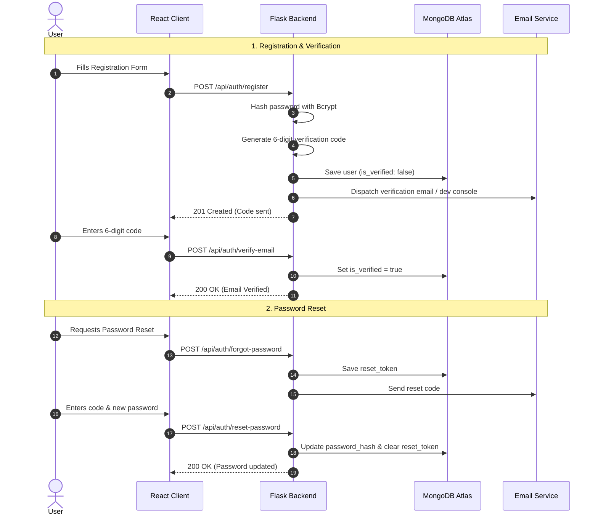

# 🔐 Authentication & Authorization Architecture

Detailed security specifications for user registration, login, JSON Web Tokens (JWT), password hashing, role enforcement, and token lifecycles.

---

## 📌 Table of Contents
- [1. Security Overview](#1-security-overview)
- [2. Password Hashing with Bcrypt](#2-password-hashing-with-bcrypt)
- [3. JSON Web Token (JWT) Architecture](#3-json-web-token-jwt-architecture)
- [4. Route Protection Decorators](#4-route-protection-decorators)
- [5. Role-Based Access Control (RBAC)](#5-role-based-access-control-rbac)
- [6. Email Verification & Password Reset Flows](#6-email-verification--password-reset-flows)
- [7. Client-Side Authentication State](#7-client-side-authentication-state)
- [8. Security Best Practices](#8-security-best-practices)

---

## 1. Security Overview

The platform uses a stateless, token-based authentication system powered by:
- **`Flask-JWT-Extended`** for server-side cryptographic token generation and claims enforcement.
- **`bcrypt`** for one-way salting and password hashing.
- **Axios Request Interceptors** for client-side bearer token management.

---

## 2. Password Hashing with Bcrypt

Passwords are never stored in plain text. When a user registers or resets their password, `bcrypt.gensalt()` generates a random cryptographic salt, and `bcrypt.hashpw()` produces a secure hash string.

### Implementation (`server/app/routes/auth.py`)
```python
import bcrypt

def hash_password(password: str) -> str:
    salt = bcrypt.gensalt(rounds=12)
    return bcrypt.hashpw(password.encode('utf-8'), salt).decode('utf-8')

def check_password(password: str, hashed: str) -> bool:
    try:
        return bcrypt.checkpw(password.encode('utf-8'), hashed.encode('utf-8'))
    except Exception:
        return False
```

---

## 3. JSON Web Token (JWT) Architecture

### Token Lifecycle & Expiration
- **Algorithm**: `HS256` (HMAC SHA-256)
- **Token Type**: Bearer Token
- **Expiration**: 7 days (Configurable via `JWT_ACCESS_TOKEN_EXPIRES`)

### Token Claims Structure
Tokens embed cryptographic identity and claims:
```json
{
  "sub": "672340a1b8c19d45e1234567",
  "username": "alex_innovator",
  "email": "alex@aisocial.local",
  "role": "user",
  "exp": 1730978400,
  "iat": 1730373600
}
```

---

## 4. Route Protection Decorators

Protected Flask endpoints utilize `@jwt_required()` to ensure incoming requests have valid signatures.

```python
from flask_jwt_extended import jwt_required, get_jwt_identity, get_jwt

@posts_bp.route('', methods=['POST'])
@jwt_required()
def create_post():
    user_id = get_jwt_identity()
    claims = get_jwt()
    # Safe to proceed with authenticated user_id
```

---

## 5. Role-Based Access Control (RBAC)

The system distinguishes between **Standard Users** and **Administrators** via custom route wrappers:

### Admin Route Guard Decorator (`server/app/routes/admin.py`)
```python
def admin_required():
    def wrapper(fn):
        @wraps(fn)
        @jwt_required()
        def decorator(*args, **kwargs):
            claims = get_jwt()
            if claims.get('role') != 'admin':
                return jsonify({"error": "Admin access required"}), 403
            return fn(*args, **kwargs)
        return decorator
    return wrapper
```

---

## 6. Email Verification & Password Reset Flows



---

## 7. Client-Side Authentication State

Client state is managed globally through `AuthContext.jsx`:
- Stores current user object in React context.
- Persists token in `localStorage.getItem('token')`.
- Axios automatically injects:
  ```javascript
  config.headers.Authorization = `Bearer ${token}`;
  ```
- Instant role recognition helper: `const isAdmin = user?.role === 'admin';`.

---

## 8. Security Best Practices

1. **Secret Entropy**: Always use cryptographically random keys for `SECRET_KEY` and `JWT_SECRET_KEY` in production (`python -c "import secrets; print(secrets.token_hex(32))"`).
2. **Account Suspension Checks**: If an admin bans an account, immediate access is revoked at the `/api/auth/login` gateway.
3. **No Credential Leaks**: Response payloads strip `password_hash`, `verification_token`, and internal salts before transmitting JSON to clients.
4. **CORS Restrictions**: Production configurations should restrict CORS origins from `*` to specific trusted client domains.
