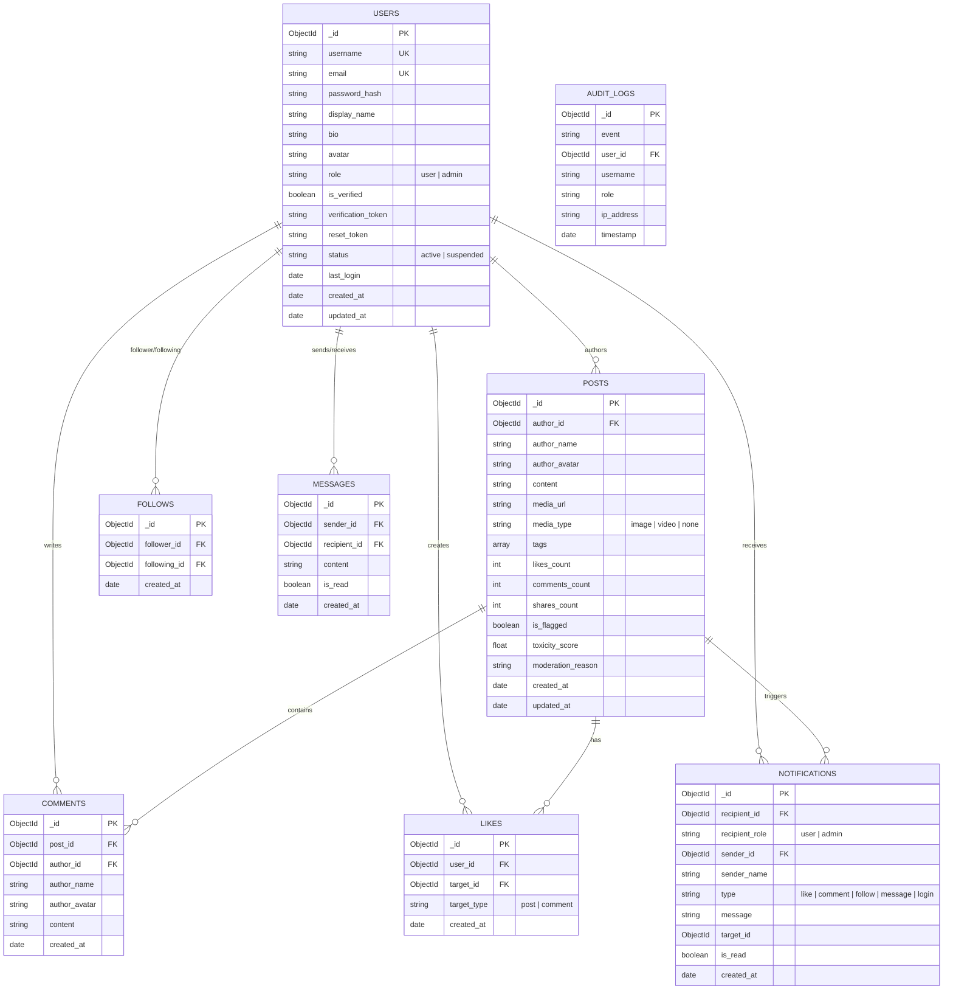

# 🗄️ MongoDB Database Schema & Architecture

Comprehensive database documentation for the **AI-Powered Social Media Platform**.

---

## 📌 Table of Contents
- [1. Overview](#1-overview)
- [2. MongoDB Atlas Connectivity](#2-mongodb-atlas-connectivity)
- [3. Entity Relationship (ER) Diagram](#3-entity-relationship-er-diagram)
- [4. Collections & Field Specifications](#4-collections--field-specifications)
  - [4.1 `users`](#41-users)
  - [4.2 `posts`](#42-posts)
  - [4.3 `comments`](#43-comments)
  - [4.4 `likes`](#44-likes)
  - [4.5 `follows`](#45-follows)
  - [4.6 `notifications`](#46-notifications)
  - [4.7 `messages`](#47-messages)
  - [4.8 `audit_logs`](#48-audit_logs)
- [5. Recommended Database Indexes](#5-recommended-database-indexes)
- [6. Security & Data Integrity](#6-security--data-integrity)

---

## 1. Overview

- **Database Engine**: MongoDB Atlas (v7.0+ / WiredTiger Storage Engine)
- **Primary Database Name**: `social_media_db` (or `ai_social_media`)
- **Driver**: `pymongo>=4.7.2` with `dnspython` for `mongodb+srv://` resolution
- **Fallback Engine**: In-memory `mongomock` driver for zero-crash offline testing and CI workflows.

---

## 2. MongoDB Atlas Connectivity

The application connects to MongoDB Atlas using an environment variable `MONGO_URI`.

### Connection String Format
```text
mongodb+srv://<db_username>:<db_password>@<cluster-address>.mongodb.net/social_media_db?retryWrites=true&w=majority
```

### Python Connection Implementation (`backend/app/db.py`)
```python
from pymongo import MongoClient
from pymongo.errors import ConnectionFailure, ServerSelectionTimeoutError
import mongomock

def get_db():
    uri = os.getenv("MONGO_URI", "mongodb://localhost:27017/social_media_db")
    try:
        client = MongoClient(uri, serverSelectionTimeoutMS=2500)
        client.admin.command('ping')
        return client['social_media_db']
    except (ConnectionFailure, ServerSelectionTimeoutError):
        # Fallback for offline development resilience
        return mongomock.MongoClient()['social_media_db']
```

---

## 3. Entity Relationship (ER) Diagram



---

## 4. Collections & Field Specifications

### 4.1 `users`
Stores user profile information, authentication hashes, and roles.

| Field | Type | Required | Description |
|---|---|---|---|
| `_id` | `ObjectId` | Yes | Primary Key |
| `username` | `String` | Yes | Unique handle (lowercase, alphanumeric + `_`, 3-30 chars) |
| `email` | `String` | Yes | Unique email address (lowercase) |
| `password_hash` | `String` | Yes | Bcrypt hashed password |
| `display_name` | `String` | No | Public display name |
| `bio` | `String` | No | User profile bio |
| `avatar` | `String` | No | Avatar image URL |
| `role` | `String` | Yes | Persona: `'user'` or `'admin'` |
| `is_verified` | `Boolean` | Yes | Email verification state (Default: `false`) |
| `verification_token`| `String` | No | 6-digit email confirmation code |
| `reset_token` | `String` | No | Password reset authorization token |
| `status` | `String` | Yes | Account status: `'active'` or `'suspended'` |
| `followers_count` | `Integer` | Yes | Total followers count (Denormalized) |
| `following_count` | `Integer` | Yes | Total following count (Denormalized) |
| `last_login` | `Date` | No | Timestamp of most recent successful login |
| `created_at` | `Date` | Yes | Account creation timestamp |
| `updated_at` | `Date` | Yes | Profile last updated timestamp |

**Example Document**:
```json
{
  "_id": { "$oid": "672340a1b8c19d45e1234567" },
  "username": "alex_innovator",
  "email": "alex@aisocial.local",
  "password_hash": "$2b$12$e8Yk2wQhZ9Yp1p/3d.QOhu5...",
  "display_name": "Alex Vance",
  "bio": "Building the future of AI-assisted social networking. 🚀",
  "avatar": "https://api.dicebear.com/7.x/bottts/svg?seed=Alex",
  "role": "user",
  "is_verified": true,
  "verification_token": null,
  "reset_token": null,
  "status": "active",
  "followers_count": 142,
  "following_count": 89,
  "last_login": { "$date": "2026-10-31T10:30:00.000Z" },
  "created_at": { "$date": "2026-10-30T08:00:00.000Z" },
  "updated_at": { "$date": "2026-10-31T10:30:00.000Z" }
}
```

---

### 4.2 `posts`
Stores social feed posts, media links, hashtags, and AI moderation scores.

| Field | Type | Required | Description |
|---|---|---|---|
| `_id` | `ObjectId` | Yes | Primary Key |
| `author_id` | `ObjectId` | Yes | Reference to `users._id` |
| `author_name` | `String` | Yes | Author's username (denormalized) |
| `author_avatar` | `String` | No | Author's avatar URL (denormalized) |
| `content` | `String` | Yes | Textual post body |
| `media_url` | `String` | No | Uploaded image or video URL |
| `media_type` | `String` | Yes | `'image'`, `'video'`, or `'none'` |
| `tags` | `Array[String]`| Yes | Array of hashtag keywords (lowercase) |
| `likes_count` | `Integer` | Yes | Total likes counter |
| `comments_count`| `Integer` | Yes | Total comments counter |
| `shares_count` | `Integer` | Yes | Total shares counter |
| `is_flagged` | `Boolean` | Yes | AI moderation status |
| `toxicity_score`| `Float` | Yes | AI moderation score (`0.00` to `1.00`) |
| `moderation_reason`| `String` | No | Explanation of why flagged |
| `created_at` | `Date` | Yes | Timestamp created |
| `updated_at` | `Date` | Yes | Timestamp modified |

**Example Document**:
```json
{
  "_id": { "$oid": "672340b2b8c19d45e1234568" },
  "author_id": { "$oid": "672340a1b8c19d45e1234567" },
  "author_name": "alex_innovator",
  "author_avatar": "https://api.dicebear.com/7.x/bottts/svg?seed=Alex",
  "content": "Just tested the AI tone polisher—it completely reshaped my post hook! 💡 #buildinpublic #ai",
  "media_url": "https://images.unsplash.com/photo-1618005182384-a83a8bd57fbe",
  "media_type": "image",
  "tags": ["buildinpublic", "ai"],
  "likes_count": 24,
  "comments_count": 5,
  "shares_count": 2,
  "is_flagged": false,
  "toxicity_score": 0.02,
  "moderation_reason": "Safe content",
  "created_at": { "$date": "2026-10-31T09:15:00.000Z" },
  "updated_at": { "$date": "2026-10-31T09:15:00.000Z" }
}
```

---

### 4.3 `comments`
Stores threaded discussions on posts.

| Field | Type | Required | Description |
|---|---|---|---|
| `_id` | `ObjectId` | Yes | Primary Key |
| `post_id` | `ObjectId` | Yes | Reference to `posts._id` |
| `author_id` | `ObjectId` | Yes | Reference to `users._id` |
| `author_name` | `String` | Yes | Author's username |
| `author_avatar` | `String` | No | Author's avatar URL |
| `content` | `String` | Yes | Comment text |
| `created_at` | `Date` | Yes | Created timestamp |

---

### 4.4 `likes`
Stores unique likes on posts or comments to prevent duplicate reactions.

| Field | Type | Required | Description |
|---|---|---|---|
| `_id` | `ObjectId` | Yes | Primary Key |
| `user_id` | `ObjectId` | Yes | Reference to `users._id` |
| `target_id` | `ObjectId` | Yes | Reference to `posts._id` or `comments._id` |
| `target_type` | `String` | Yes | `'post'` or `'comment'` |
| `created_at` | `Date` | Yes | Timestamp of like |

*Compound Unique Index*: `(user_id, target_id)` prevents double-liking.

---

### 4.5 `follows`
Represents follower/following relationships between platform users.

| Field | Type | Required | Description |
|---|---|---|---|
| `_id` | `ObjectId` | Yes | Primary Key |
| `follower_id` | `ObjectId` | Yes | User who initiated the follow |
| `following_id`| `ObjectId` | Yes | User being followed |
| `created_at` | `Date` | Yes | Timestamp followed |

*Compound Unique Index*: `(follower_id, following_id)`.

---

### 4.6 `notifications`
Stores live user alerts and administrator security signals.

| Field | Type | Required | Description |
|---|---|---|---|
| `_id` | `ObjectId` | Yes | Primary Key |
| `recipient_id` | `ObjectId` | No | Target user ID (optional if role-targeted) |
| `recipient_role`| `String` | No | Target persona (`'admin'` or `'user'`) |
| `sender_id` | `ObjectId` | No | Initiator user ID |
| `sender_name` | `String` | No | Initiator's username |
| `type` | `String` | Yes | `'like'`, `'comment'`, `'follow'`, `'login'`, `'system'` |
| `message` | `String` | Yes | Human-readable alert notification text |
| `target_id` | `ObjectId` | No | Associated post or comment ID |
| `is_read` | `Boolean` | Yes | Default: `false` |
| `created_at` | `Date` | Yes | Timestamp created |

---

### 4.7 `messages`
Stores direct peer-to-peer messages.

| Field | Type | Required | Description |
|---|---|---|---|
| `_id` | `ObjectId` | Yes | Primary Key |
| `sender_id` | `ObjectId` | Yes | Reference to sending `users._id` |
| `recipient_id`| `ObjectId` | Yes | Reference to receiving `users._id` |
| `content` | `String` | Yes | Encrypted or plain message body |
| `is_read` | `Boolean` | Yes | Read receipt status |
| `created_at` | `Date` | Yes | Sent timestamp |

---

### 4.8 `audit_logs`
Tracks admin-related platform activities and login security events.

| Field | Type | Required | Description |
|---|---|---|---|
| `_id` | `ObjectId` | Yes | Primary Key |
| `event` | `String` | Yes | Event name (e.g. `'user_login'`, `'user_banned'`) |
| `user_id` | `ObjectId` | Yes | Actor user ID |
| `username` | `String` | Yes | Actor username |
| `role` | `String` | Yes | Actor role |
| `ip_address` | `String` | No | Client IP address |
| `timestamp` | `Date` | Yes | Timestamp of event |

---

## 5. Recommended Database Indexes

To achieve high read/write performance at scale, the following MongoDB indexes should be maintained:

```javascript
// users collection
db.users.createIndex({ "username": 1 }, { unique: true });
db.users.createIndex({ "email": 1 }, { unique: true });
db.users.createIndex({ "status": 1 });

// posts collection
db.posts.createIndex({ "created_at": -1 });
db.posts.createIndex({ "author_id": 1, "created_at": -1 });
db.posts.createIndex({ "tags": 1 });
db.posts.createIndex({ "is_flagged": 1 });

// comments collection
db.comments.createIndex({ "post_id": 1, "created_at": 1 });

// likes collection
db.likes.createIndex({ "user_id": 1, "target_id": 1 }, { unique: true });

// follows collection
db.follows.createIndex({ "follower_id": 1, "following_id": 1 }, { unique: true });
db.follows.createIndex({ "following_id": 1 });

// notifications collection
db.notifications.createIndex({ "recipient_id": 1, "is_read": 1, "created_at": -1 });
db.notifications.createIndex({ "recipient_role": 1, "created_at": -1 });

// messages collection
db.messages.createIndex({ "sender_id": 1, "recipient_id": 1, "created_at": -1 });
```

---

## 6. Security & Data Integrity

1. **Password Safety**: Passwords must never be stored in plain text. Always use salted Bcrypt hashes (`cost factor >= 12`).
2. **Access Controls**: Application queries must verify `status !== 'suspended'` prior to granting token access.
3. **Soft vs. Hard Delete**: Deleting posts cascades deletion to child `comments` and associated `likes` documents.
4. **Environment Secrets**: Database credentials must strictly reside in `.env` and never be committed to source control.
