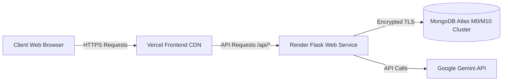

# 🚀 Production Deployment & Cloud Hosting Guide

Step-by-step instructions for deploying the **AI-Powered Social Media Platform** to cloud hosting platforms (**Vercel**, **Render**, and **MongoDB Atlas**).

---

## 📌 Table of Contents
- [1. Deployment Architecture](#1-deployment-architecture)
- [2. MongoDB Atlas Production Configuration](#2-mongodb-atlas-production-configuration)
- [3. Backend Deployment (Render / Railway)](#3-backend-deployment-render--railway)
- [4. Frontend Deployment (Vercel)](#4-frontend-deployment-vercel)
- [5. Environment Variables Checklist](#5-environment-variables-checklist)
- [6. Security & Pre-Production Checklist](#6-security--pre-production-checklist)

---

## 1. Deployment Architecture



- **Frontend**: Hosted on **Vercel** with global edge CDN delivery.
- **Backend API**: Hosted on **Render** (or **Railway**) using Gunicorn WSGI server.
- **Database**: Hosted on **MongoDB Atlas** with automatic daily backups and IP access lists.

---

## 2. MongoDB Atlas Production Configuration

1. **Create Dedicated Database User**:
   - Go to **Security > Database Access**.
   - Create a user with **`readWriteAnyDatabase`** or specific read/write access to `social_media_db`.
   - Use a strong, random password (avoid special characters that require URL-encoding, such as `#`, `@`, or `%`).
2. **Configure Network Access**:
   - Go to **Security > Network Access**.
   - For Render/Railway dynamic IPs, add `0.0.0.0/0` (Allow Access from Anywhere).
   - Ensure your database user credentials remain strictly in private environment variables.
3. **Copy Connection URI**:
   - Click **Connect > Drivers > Python**.
   - Format:
     ```text
     mongodb+srv://<username>:<password>@cluster0.xxxxxx.mongodb.net/social_media_db?retryWrites=true&w=majority
     ```

---

## 3. Backend Deployment (Render / Railway)

### 3.1 Gunicorn Production WSGI Server
Update `requirements.txt` to include `gunicorn`:
```text
gunicorn==22.0.0
```

### 3.2 Create Render Web Service
1. Connect your GitHub repository to [Render](https://render.com).
2. Choose **Web Service**.
3. **Root Directory**: `server` (or `backend`).
4. **Environment**: `Python 3`.
5. **Build Command**:
   ```bash
   pip install --upgrade pip && pip install -r requirements.txt
   ```
6. **Start Command**:
   ```bash
   gunicorn run:app --bind 0.0.0.0:$PORT --workers 4 --timeout 120
   ```

---

## 4. Frontend Deployment (Vercel)

### 4.1 Deploying via Vercel Dashboard
1. Log in to [Vercel](https://vercel.com) and click **Add New > Project**.
2. Select your GitHub repository: `AI-Powered-Social-Media-Platform`.
3. Set **Root Directory** to `client`.
4. **Framework Preset**: `Vite`.
5. **Build Command**: `npm run build`.
6. **Output Directory**: `dist`.

### 4.2 Configure Vercel API Rewrites (`client/vercel.json`)
To route `/api/*` requests directly to your live backend:

```json
{
  "rewrites": [
    {
      "source": "/api/:path*",
      "destination": "https://your-backend-api.onrender.com/api/:path*"
    },
    {
      "source": "/(.*)",
      "destination": "/index.html"
    }
  ]
}
```

---

## 5. Environment Variables Checklist

### Backend Environment Variables (Render Dashboard):
| Variable Name | Production Value Example |
|---|---|
| `PORT` | `5000` |
| `SECRET_KEY` | *(Generate via `python -c "import secrets; print(secrets.token_hex(32))"`)* |
| `JWT_SECRET_KEY` | *(Generate random 64-char hex string)* |
| `MONGO_URI` | `mongodb+srv://<user>:<pwd>@cluster0.mongodb.net/social_media_db?...` |
| `GEMINI_API_KEY` | `AIzaSy...` (From Google AI Studio) |
| `SMTP_SERVER` | `smtp.gmail.com` |
| `SMTP_PORT` | `587` |
| `SMTP_USER` | `notifications@yourdomain.com` |
| `SMTP_PASSWORD` | App-specific password |
| `EMAIL_FROM` | `Aura Social <noreply@yourdomain.com>` |

---

## 6. Security & Pre-Production Checklist

- [ ] All `.env` files are confirmed excluded from Git (`git status` shows clean).
- [ ] Strong random strings are used for `SECRET_KEY` and `JWT_SECRET_KEY`.
- [ ] Flask debug mode is disabled in production (`debug=False`).
- [ ] CORS allowed origins are restricted to the production frontend domain.
- [ ] SSL/HTTPS certificate is active on both frontend and backend domains.
- [ ] Test admin credentials default password is changed immediately upon initial deployment.
